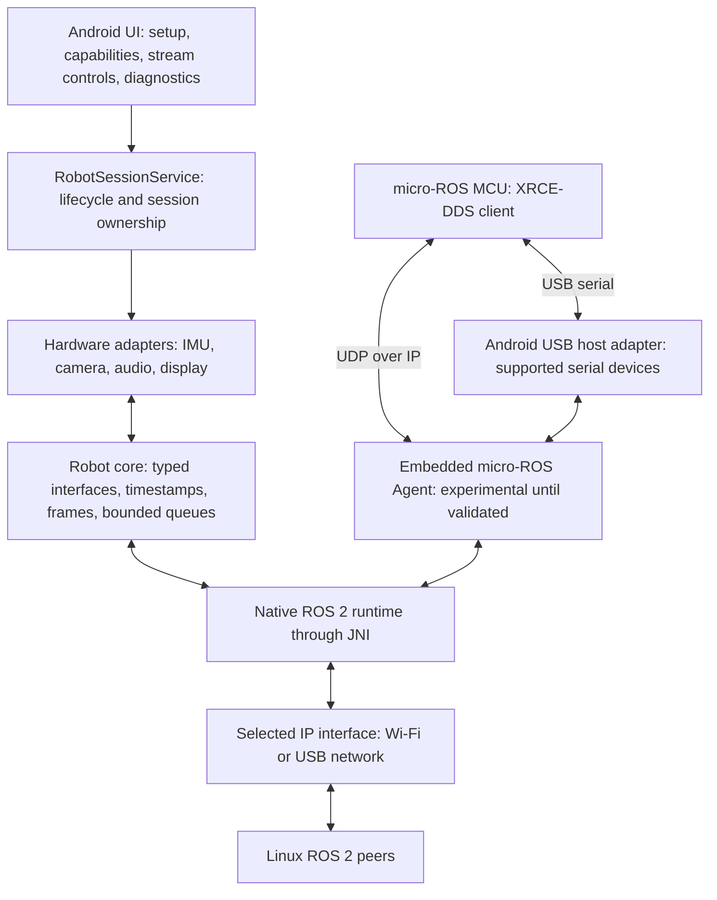

# Architecture and implementation strategy

The [ROS2 Android platform plan](docs/PLATFORM-PLAN.md) defines the expanded
phone-as-robot-computer direction, PC development workflow, user-node execution,
launch compatibility, camera performance and delivery milestones. It supersedes
conflicting future-work proposals below; existing verification remains historical
evidence.

Planning baseline: 2026-10-24. This document records proposed decisions.
The Kotlin app and native Jazzy `rcl` runtime are implemented. PC/phone ROS
round trips have passed over Wi-Fi and USB networking. The phone-hosted Agent
is v0.2 work and remains unimplemented. See `docs/V0.1.md`,
`docs/DEVELOPMENT.md`, and `docs/verification/` for current behavior and evidence.

Release boundary: v0.1 is PC ↔ phone over USB and network; v0.2 is
microcontroller ↔ phone over USB and network.

## Product goal and compatibility

A reusable Android app turns a phone into a robot's computing and sensing
unit. It can operate with Linux ROS 2 peers, micro-ROS microcontrollers, or
both. A Linux computer is useful during development but must not be required
in the final phone-plus-microcontroller configuration.

Support a broad range of phones through capability detection. Literal support
for every Android version, sensor, and USB controller is not achievable.
Provisional first build target: Android 8.0/API 26 or newer, arm64-v8a, no root.
This is a project starting point, subject to the native dependency build and
the connected phone's actual API/ABI. Add 32-bit ARM and older Android only
after checking toolchain feasibility and testing representative devices.
Choose current compile/target SDK versions when provisioning the toolchain;
minimum SDK and target SDK serve different purposes.

Linux ROS 2 Jazzy is the initial interoperability reference because it is
installed on this PC. Pin native source revisions and middleware versions
after the first interoperability proof. Other ROS distributions are later
tested combinations, not assumed compatible.

## System structure



The Agent/ROS connection above represents DDS participation in the same domain,
not a second application-level topic relay. Whether both can share native
dependencies safely is part of the feasibility work.

## Implementation decisions

| Area | Starting decision | Reason |
| --- | --- | --- |
| Android app | Kotlin, small native Android UI | Direct access to Android hardware and lifecycle APIs |
| ROS integration | C++ ROS 2 library through JNI | Native ROS behavior, narrow Android-facing APIs |
| Native client API | Jazzy `rcl` C API inside C++ | Smaller cross-build; direct typed endpoints without exposing native ownership to Kotlin |
| Alternate binding | Evaluate rcljava during the build experiment | Existing Android bindings, but historical build instructions require current compatibility verification |
| Middleware | Cyclone DDS, pinned 0.10.x revision | Android cross-build and PC Fast DDS interoperability verified; Agent DDS integration remains a separate v0.2 gate |
| Microcontroller integration | micro-ROS Agent hosted on phone, planned for v0.2 | Required for the intended standalone phone-plus-MCU topology |
| Data contract | Fixed, versioned ROS interface set initially | Predictable generation, packaging, memory, and interoperability |
| Sensor APIs | SensorManager, CameraX where supported, AudioRecord, TextToSpeech | Use Android APIs behind replaceable capability adapters |
| Build | Gradle wrapper plus CMake/NDK and reproducible native dependency build | Keep Android app builds separate from ROS cross-compilation |

The v0.1 runtime choice has passed proof builds and physical transport checks.
Do not assume the standard Linux micro-ROS Agent binary runs on Android. Android's
native environment, socket handling, USB access, and dependency packaging need
porting and tests. Avoid a mandatory Termux, root, or Linux-container dependency.

## Connection modes

1. **Linux peer over Wi-Fi:** phone and PC participate in the ROS 2 DDS domain.
   Start with one selected interface and explicit peer configuration where
   multicast discovery fails. Domain ID alone is not connectivity or security.
2. **Linux peer over USB:** first evaluate USB tethering as an IP interface.
   ADB forwarding can assist development but does not directly carry DDS UDP
   or prove the production USB path. Accessory mode is a later alternative if
   target phones cannot provide usable USB networking.
3. **Micro-ROS MCU over Wi-Fi/UDP:** MCU sends XRCE-DDS to the phone-hosted Agent;
   the phone's native ROS nodes communicate with the entities the Agent exposes.
4. **Micro-ROS MCU over USB:** phone acts as USB host/OTG. Android obtains USB
   permission; a supported USB serial adapter supplies bytes to an Agent
   transport integration. Preserve the firmware's XRCE serial framing. Do not
   assume an Android app can open a Linux `/dev/ttyACM0` path or feed bytes into
   the unmodified Linux Agent serial transport.

An ESP32/Arduino board is supported only when its firmware, memory, micro-ROS
version, transport, and USB hardware are compatible. Start with one board and
one USB serial implementation; expand through a published compatibility matrix.
Plain serial firmware uses a separate protocol adapter and is not micro-ROS.

USB host/device roles also affect debugging and charging: phone-to-PC and
phone-to-MCU are different arrangements. Do not assume simultaneous OTG,
charging, and wired ADB. Validate powered hubs and power delivery per device.

## Module boundaries

Proposed source layout; create modules as their milestones begin:

```text
android/app/                  UI, permission flow, session service
android/core/                 configuration, capability model, session state
android/hardware/             phone hardware adapters
android/ros/                  Kotlin facade and JNI lifecycle
native/ros_runtime/           ROS nodes, executors, message conversion
native/micro_ros_agent/       embedded Agent integration
android/usb/                  USB discovery, permissions, serial adapters
interfaces/                   custom .msg/.srv/.action definitions if needed
tools/                        dependency build and device verification scripts
docs/verification/            tested environment and milestone evidence
```

Kotlin owns permissions and Android resources. Native code owns ROS contexts,
executors, nodes, and Agent objects. A session owns both and closes them in a
defined order. Never run ROS spinning, USB blocking I/O, or image conversion on
the UI thread. JNI reports structured errors and releases buffers explicitly.
Use bounded queues; drop stale sensor samples instead of building latency.
Large camera/audio buffers need measured copy costs before optimization.

Session states: stopped → starting → running → reconnecting or error → stopping
→ stopped. Start/stop must be idempotent. Surface permission denial, missing
sensors, USB removal, peer loss, and native build/runtime errors separately.
Peer heartbeat indicates liveness; discovery alone does not prove data flow.

## ROS and hardware contracts

Use configurable robot/device namespaces; `/phone` is the initial example.
Maintain an explicit topic type/direction/QoS registry. Custom message changes
require synchronized generated code on all participating endpoints.

| Stream | First contract | Initial policy |
| --- | --- | --- |
| Heartbeat | `std_msgs/msg/String` | 1 Hz; reliable, volatile, small queue |
| Test input | `std_msgs/msg/String` | Reliable, volatile; visible receipt |
| IMU | `sensor_msgs/msg/Imu` | Start at 50 Hz; best effort, volatile; configurable |
| Camera | `sensor_msgs/msg/Image` + `CameraInfo` | Start at 640×480, 10 fps if supported; best effort |
| Display and speech requests | `std_msgs/msg/String` | Reliable, volatile; rate/length limits |
| Microphone | Decide before implementation | Declare encoding, channels, rate, timestamps and chunk size |

These are application defaults to test, not guarantees. Raw image bandwidth
is substantial; add a standard compressed-image path after the basic stream
works. Missing calibration, orientation, and covariance must use the relevant
message conventions rather than invented precision.

Map Android monotonic acquisition times into a documented ROS timestamp policy;
handle clock jumps and cross-device synchronization explicitly. Define physical
phone and optical frames, units, and mounting transforms before publishing IMU
or camera data. Verify axes by physically rotating the phone.

Start user-triggered robot sessions from a visible activity. Select applicable
foreground-service types and permissions for each supported Android release.
Test screen-off, background, revocation, and vendor battery restrictions before
claiming unattended operation. Missing hardware disables only that capability.

Microcontrollers own actuator timing, command expiry, and fail-safe stop. Phone
commands are higher-level requests. Reconnection must never replay old movement
commands. Initially use a trusted local network and test data; before physical
control, define authorization and network security explicitly.

## Delivery strategy and decision gates

| Step | Work | Exit evidence |
| --- | --- | --- |
| 0: Toolchain and inventory | Obtain ADB/SDK/NDK; inspect authorized phone API, ABI, USB modes; verify Jazzy reference | Reproducible tool versions and device facts, no private identifiers committed |
| 1: Native ROS proof | Cross-compile minimal runtime; install tiny publisher/subscriber app | Both directions verified with Linux ROS CLI over Wi-Fi; pin successful revisions |
| 2: Linux USB path | Enable/test tethered IP and interface selection | Same topic proof over USB with Wi-Fi disabled; cable removal/reconnect tested |
| 3: Phone-hosted Agent proof | Port/embed Agent; first use UDP MCU transport | A real micro-ROS MCU exchanges typed data with a phone node without a Linux Agent |
| 4: MCU USB path | Implement one Android USB serial/Agent transport integration | Real board exchanges data with phone; no PC Agent; detach and permission tests pass |
| 5: Phase 1 app | Integrate connection profiles, status and lifecycle controls | Repeated start/stop, reconnect and a measured 30-minute session per supported topology |
| 6: Phase 2 sensors | IMU → camera → display/speech → microphone → optional sensors | Per-feature permission, format, rate, timestamp and physical-sensor checks |

Run the Agent dependency/build feasibility check during step 1, before investing
in the full application. Step 3 completes its hardware/runtime validation. If
embedding fails, record the blocker and evaluate a port or a different compatible
Agent integration. A PC-hosted Agent is a useful temporary test arrangement,
but does not satisfy the standalone product requirement. Do not silently replace
native ROS with a remote bridge.

Build only the dependencies needed for these proofs. Pin successful revisions,
document patches and licenses, package artifacts with checksums, and keep SDK,
NDK, generated output, binaries, device IDs, and logs out of source control.
Use emulator tests for UI and permission flows; use physical devices for sensors,
USB roles, middleware networking, and thermal behavior. Broaden OS/ABI support
after the reference combination passes, using a per-feature compatibility matrix.

## Machine observations before implementation

Read-only checks on 2026-10-24 found `/opt/ros/jazzy`, Java 21, and a USB device
identifying itself as Realme. No ADB or Gradle executable was found on PATH,
and no Android SDK was found in the checked standard locations. Phone model,
Android version, CPU ABI, ADB authorization, and native compatibility remain
unverified. USB enumeration alone does not establish debugging access.

## Sources and limits

- [ROS 2 Java/Android bindings and build instructions](https://github.com/ros2-java/ros2_java)
- [micro-ROS Agent role](https://github.com/micro-ROS/micro-ROS-Agent)
- [micro-ROS PlatformIO transport examples](https://github.com/micro-ROS/micro_ros_platformio)
- [Android USB host APIs and permissions](https://developer.android.com/develop/connectivity/usb/host)
- [Android foreground-service restrictions](https://developer.android.com/develop/background-work/services/fgs/restrictions-bg-start)

Sources establish available APIs and protocol roles. Android Agent portability,
the chosen ROS/NDK combination, and device behavior are hypotheses requiring
the milestone evidence above.
