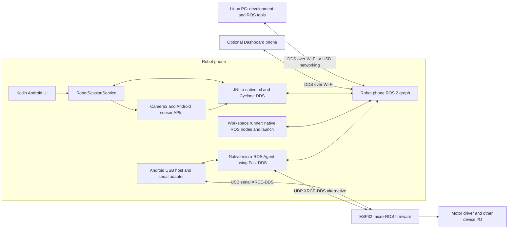

# Architecture

ROS2 Android runs native ROS 2 on Android. Kotlin provides the Android user
interface and hardware integration; C/C++ provides the ROS runtime. There is no
Ubuntu container, root requirement or mandatory PC-side ROS bridge.

DDS is the shared ROS data plane, not a relay service hosted by the PC. Native
phone publishers, workspace nodes, the Agent and other phones/PCs participate
in the same domain. The Agent exposes MCU entities to that graph; it does not
route all phone-to-PC traffic.

## Main Android app

The main APK contains Kotlin screens, Android hardware adapters, a native ROS
runtime and the micro-ROS Agent integration. Its five tabs are Home, Sensors,
Dashboard, Projects and Settings. Android permissions remain under user control.

`RobotSessionService` owns sensor endpoints, Dashboard publishers/subscribers
and active hardware resources. Activities display/control that state rather
than owning its lifetime. Changing tabs does not stop sessions. Foreground
service and wake resources support active operation, but Android/vendor process
limits still apply; this is not a hard real-time operating system.

JNI is the boundary between Kotlin and the native ROS layer. The main runtime
uses Jazzy `rcl` with `rmw_cyclonedds_cpp`/Cyclone DDS. Native code owns contexts,
nodes, executors and ROS messages; Kotlin owns Android permissions and hardware.
Fixed, generated message interfaces are supported by the app; arbitrary custom
message types are not automatically available in Dashboard widgets.

## Camera and Dashboard pipeline

Camera2 supplies YUV frames to a bounded capture/encoding pipeline. Frames are
JPEG-encoded and published as `sensor_msgs/msg/CompressedImage`. FPS selection
uses advertised normal capture ranges and the selected size's frame duration.
FPS 0 selects automatic maximum; a higher request cannot exceed hardware support.
Resolution choices come from advertised YUV sizes. Quality is configurable.

Dashboard image subscriptions receive JPEG/PNG messages, decode off the UI thread
and render with aspect ratio preserved. Latest-frame queues drop stale work
instead of accumulating delay. Memory, payload and image-dimension checks remain;
this is not a guaranteed latency or 4K/30 FPS pipeline. Constrained high-speed
Camera2 sessions and raw `Image` Dashboard subscriptions are not implemented.

## Workspace execution

The Linux host tools inspect supported packages and cross-compile against an
Android ROS SDK using the Android NDK. The NDK targets Android's native ABI and
Bionic C library; copying Linux ARM binaries onto Android is insufficient.

The build packages executable code, dependencies, interfaces and resources into
a workspace runner APK. Currently there is **one runner APK per workspace**, in
addition to the main app. Runners have no app-drawer entry. The main app discovers
compatible runners and controls them through an explicit, signature-protected
Android service. Main app and runners must use matching signing identities.

The ordinary C++ workspace backend supervises native child processes. The shell
bundle provides ROS CLI commands and native LaunchService. Python/rclpy and
launch support have qualification limits; a Linux workspace with arbitrary
system dependencies is not automatically Android-compatible. Developer shell
processes started outside the project supervisor are not managed by its card.
See [workspace compatibility](docs/COLCON-WORKSPACES.md),
[Python projects](docs/PYTHON-PROJECTS.md) and [Android shell](docs/ANDROID-SHELL.md).

## ESP32 and other microcontrollers

The ESP32 runs micro-ROS firmware using XRCE-DDS. The phone hosts the native Agent
using Fast DDS. USB mode uses Android USB host permission, a supported serial
driver and a framing-preserving transport adapter. UDP mode uses the same Agent
role over IP. A PC Agent is not required for these phone-hosted paths.

Reference robot flow: Dashboard/PC publishes `/cmd_vel` → DDS → phone Agent →
USB XRCE-DDS → ESP32 callback → motor-driver outputs. MCU feedback travels back
through the Agent as ordinary ROS topics. The MCU owns actuator timing and
command expiry; the reference firmware stops stale commands independently of UI
navigation or PC availability. This example is not a certified motion controller.

Firmware programming is a separate maintenance path: PC esptool commands travel
through the phone's exclusive USB programming bridge to the ESP32 ROM loader.
It temporarily replaces the Agent's USB ownership. It is not the micro-ROS data
transport. See [programming guide](docs/ESP32-PROGRAMMING.md).

## Networking and trust

Wi-Fi and PC USB tethering carry ROS DDS over IP. Phone-to-MCU USB is serial
XRCE-DDS, a different transport. ADB is for authorized development/deployment and
is not needed for ordinary Dashboard-to-robot traffic.

Automatic discovery uses multicast on networks that permit it; explicit peers
are a fallback. Matching domain IDs, reachable interfaces and compatible QoS are
required. Guest Wi-Fi/client isolation/firewalls can prevent discovery or data.
A domain ID is not authentication. Current operation assumes a trusted network;
do not expose development/programming endpoints to the internet.

## Compatibility and evidence

Android API 26+ / ARM64 is the build target, not a promise that every phone has
been qualified. Reference Linux interoperability is ROS 2 Jazzy. See
[status and validation](docs/STATUS.md) for tested paths and remaining work.
Dependency versions and Android patches are tracked in `native/` lock files.
