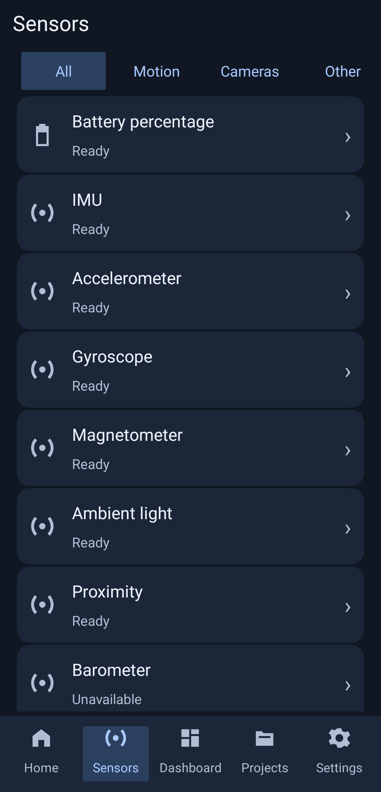
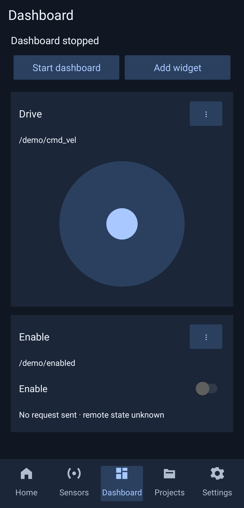
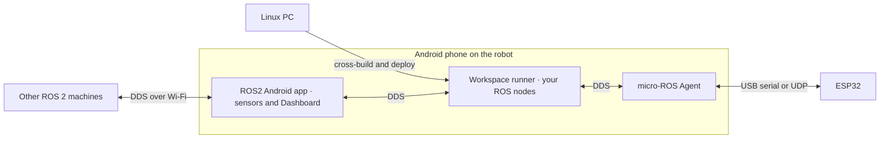

<p align="center">
  
</p>

<h1 align="center">ROS2 Android</h1>

<p align="center"><b>Turn an Android phone into your robot's onboard ROS 2 computer.</b></p>

<p align="center">
  <a href="https://github.com/kishore-saravanan/ros2-android/releases"></a>
  
  
  <a href="LICENSE"></a>
  <a href="https://github.com/sponsors/kishore-saravanan"></a>
</p>

A phone already has a fast ARM computer, cameras, an IMU, Wi-Fi and a battery.
ROS2 Android runs **native ROS 2 Jazzy on the phone itself**: no Ubuntu, no root,
no container. Publish the phone's sensors, run your own ROS nodes on it, talk to
microcontrollers over USB or Wi-Fi, and drive it all from a touch Dashboard.
Build on your Linux PC, deploy over Wi-Fi while the phone stays mounted on the robot,
and keep running with no PC at all.

## See it drive

https://github.com/user-attachments/assets/cf2f065b-a2af-451b-9734-392699fe368c

The **onboard phone** captures the camera, runs Python ROS 2 perception and motion
control, and hosts the micro-ROS Agent for the **ESP32** that drives the motors. A
second, **remote phone** starts and stops tracking and shows the annotated image.
Everything in the loop runs on the robot. [Build this example →](docs/BALL-FOLLOWER.md)

## What you can do

| | |
| --- | --- |
| **Publish phone sensors** | IMU, accelerometer, gyroscope, magnetometer, barometer, battery and cameras (with resolution, FPS and JPEG controls), each on an editable topic and rate. |
| **Run your own nodes on the phone** | Cross-build supported C++ and Python ROS 2 workspaces on Linux, deploy them, then start and stop them from the app's Projects tab. |
| **Develop on a mounted robot** | Deploy over wireless ADB while the phone stays on the robot. Nodes run on the phone, not on your PC. |
| **Connect microcontrollers** | A micro-ROS Agent on the phone serves an ESP32 over USB OTG or Wi-Fi (UDP). You can even flash a USB-attached ESP32 *through* the phone. |
| **Control and monitor** | A Dashboard with buttons, switches, sliders, a joystick, live values and camera images. |
| **Run without a PC** | Once deployed, the phone, its nodes and its microcontroller keep working with Wi-Fi off. |

<table>
  <tr>
    <td align="center"><br><b>Home</b></td>
    <td align="center"><br><b>Sensors</b></td>
    <td align="center"><br><b>Dashboard</b></td>
    <td align="center"><br><b>Projects</b></td>
  </tr>
</table>

## Develop while the phone stays on the robot

No unmounting, no cables to the robot, no compiling on the phone. Your PC builds;
the phone runs.

1. **Connect once over wireless debugging** (Android 11+: Developer options →
   Wireless debugging → Pair device with pairing code):

   ```bash
   adb pair PHONE_IP:PAIRING_PORT     # enter the code shown on the phone
   adb connect PHONE_IP:PORT
   ```

2. **Build on your PC and deploy over Wi-Fi** (with the [native SDK](docs/CLEAN-MACHINE-SETUP.md#3-prepare-the-project-sdk) installed):

   ```bash
   ros2-android workspace --workspace ~/my_ws build --controller-apk ros2-android-1.0.0.apk
   ros2-android workspace --workspace ~/my_ws --serial PHONE_IP:PORT deploy
   ```

3. **Start it** from the app's Projects tab (approve the new project once), and watch
   its topics from your PC. Edit, rebuild and redeploy the same way.

The nodes run on the phone, so the robot keeps going when the PC disconnects. The
ESP32 on the robot stays attached to the phone too: flash new firmware into it
**through the phone** over the same wireless link ([guide](docs/ESP32-PROGRAMMING.md)).
Flashing an ESP32 over its own Wi-Fi (OTA) is not supported.
[Workspace guide →](docs/COLCON-WORKSPACES.md)

## Install

Download from the [latest release](https://github.com/kishore-saravanan/ros2-android/releases):

| File | Who needs it |
| --- | --- |
| `ros2-android-1.0.0.apk` | Everyone: the Android app (ARM64, Android 8.0+). |
| `ros2-android_1.0.0-1_all.deb` | Ubuntu 24.04 PCs: the `ros2-android` command-line tool, with the app inside it. |
| `ros2-android-native-sdk-1.0.0-arm64-v8a.tar.xz` | Only if you build your own workspaces for the phone. |
| `SHA256SUMS` | To check your downloads. |

Check that the APK really comes from this project. Its signing certificate is listed in
[SECURITY.md](SECURITY.md#verify-a-downloaded-apk).

**Just the app:** install the APK on your phone and open it. Sensors and the Dashboard
work with any ROS 2 Jazzy PC on the same network.

**PC tool and app together:**

```bash
sudo apt install ./ros2-android_1.0.0-1_all.deb
ros2-android device setup        # installs the bundled app on a USB-connected phone
```

Enable USB debugging on the phone and authorize the PC first. Installing the PC
package never touches a phone by itself.

## Your first message in five minutes

1. Put the phone and a ROS 2 Jazzy PC on the same Wi-Fi network.
2. In the app, open **Sensors → Battery percentage** and tap **Publish**.
3. On the PC:

   ```bash
   source /opt/ros/jazzy/setup.bash
   ros2 topic echo /phone/battery_percent std_msgs/msg/Float64 --qos-reliability best_effort
   ```

You should see the phone's battery level arrive once a second.
[Full walkthrough and troubleshooting →](docs/GETTING-STARTED.md)

## Guides

| I want to… | Read |
| --- | --- |
| Install and publish a first topic | [Getting started](docs/GETTING-STARTED.md) |
| Build and deploy my own workspace to the phone | [Workspaces](docs/COLCON-WORKSPACES.md) · [Set up a build PC](docs/CLEAN-MACHINE-SETUP.md) |
| Configure buttons, joystick, values and images | [Dashboard](docs/CONTROLS.md) |
| Connect an ESP32 over USB or Wi-Fi | [ESP32 over USB](docs/ESP32-USB.md) · [ESP32 over Wi-Fi](docs/ESP32-WIFI.md) · [Flash through the phone](docs/ESP32-PROGRAMMING.md) |
| Run the robot without a PC | [Robot operation](docs/ROBOT-OPERATION.md) · [Standalone operation](docs/STANDALONE-OPERATION.md) |
| Check whether my phone is supported | [Compatibility](docs/COMPATIBILITY.md) · [Qualify a phone](docs/PHONE-QUALIFICATION.md) |

## How it works

Kotlin owns the Android UI, permissions and hardware. JNI connects it to native ROS 2
Jazzy (`rcl`, Cyclone DDS). Each deployed workspace runs in its own runner app; the
micro-ROS Agent bridges microcontroller nodes into the ROS graph.



More: [architecture](ARCHITECTURE.md) · [design](docs/design/HIGH-LEVEL-DESIGN.md) · [roadmap](docs/ROADMAP.md)

## What's tested

1.0.0 is the first public release. It has been tested on a Realme phone
(Android 12), a Samsung Galaxy S24+ (Android 17) and an Android 15 emulator, with an
ESP32 over USB (CP2102) and Wi-Fi. Results are in [Status](docs/STATUS.md).
Things to know:

- **Keep the app open with the screen on for long runs** (it keeps the screen awake).
  With the screen off on battery, vendor power management stopped it after about 12
  minutes on the Realme. Also **allow background activity** for the app and each project;
  Samsung can still pause projects in the background. See [standalone operation](docs/STANDALONE-OPERATION.md).
- **Supported workspaces only:** not every Linux ROS package builds for Android.
- **Trusted networks only:** ROS traffic is not encrypted or authenticated.
- **No hard real-time guarantees.** The Dashboard is not an emergency stop.

## Report a bug or request a feature

- **Something broke?** [Open a bug report](https://github.com/kishore-saravanan/ros2-android/issues/new?template=bug_report.md)
  with the app version, phone model, Android version and steps to reproduce.
- **Tried it on your phone?** [Send a phone report](https://github.com/kishore-saravanan/ros2-android/issues/new?template=phone_report.md),
  whether it worked or not. Reports from new phones are among the most useful contributions.
- **Missing something?** [Request a feature](https://github.com/kishore-saravanan/ros2-android/issues/new?template=feature_request.md).
- **Security issue?** Report it privately as described in [SECURITY.md](SECURITY.md), never in a public issue.

Please leave out personal data: no serial numbers, IP addresses, photos or raw phone logs.

## Contribute

Contributions are welcome in runtime reliability, Android UX, workspace support,
tests and documentation. Start with [Contributing](CONTRIBUTING.md) and
[build and test](docs/DEVELOPMENT.md). See also the [changelog](CHANGELOG.md),
[release process](docs/RELEASING.md) and [security policy](SECURITY.md).

## Support development

ROS2 Android is built by Kishore Saravanan. If it's useful to you, you can support its
development through [GitHub Sponsors](https://github.com/sponsors/kishore-saravanan).
The same link is under Settings → About in the app.

## License and citation

Apache-2.0, copyright 2026 Kishore Saravanan; see [LICENSE](LICENSE) and [NOTICE](NOTICE).
Dependencies keep their own licenses, listed in [third-party notices](THIRD-PARTY-NOTICES.md)
and viewable in the app under Settings → About → Open-source licenses. If you use the
project in research, please cite [CITATION.cff](CITATION.cff).
