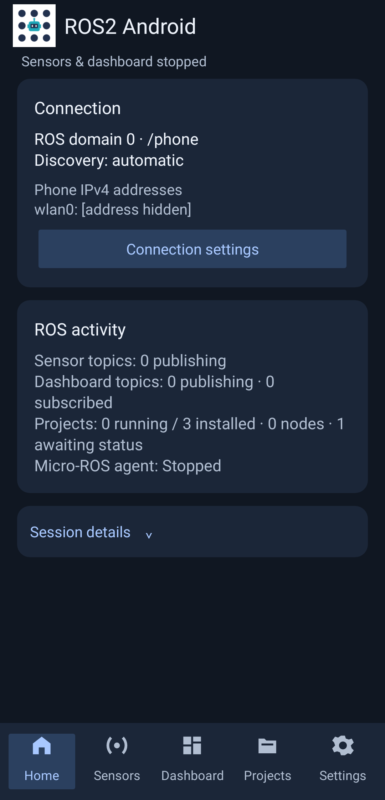
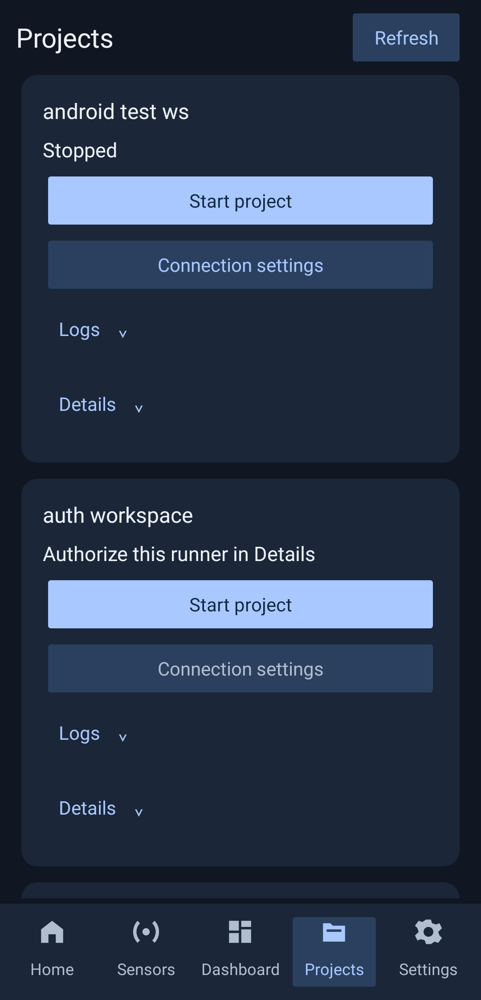
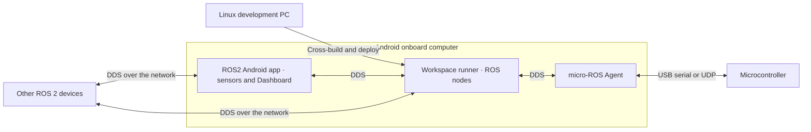

  

# ROS2 Android

**Your phone. Your ROS nodes. Your robot.**

Use an Android phone as a robot's onboard ROS 2 computer: run supported nodes
locally, publish phone sensors, connect microcontrollers and configure a control
Dashboard. Develop on Linux and deploy to the phone over USB or Wi-Fi.

The phone runs native ROS 2 without Ubuntu, root, a container or a mandatory PC
relay. This project is a reusable platform; ball following is an optional
proof-of-concept application, not the product's primary purpose.

**Development preview: 0.1.1-dev6 · ROS 2 Jazzy · Android ARM64 · Apache-2.0.**
There is no stable release or public APT repository yet. Android API 26 is the
build minimum; supported hardware and runtime evidence are described in
[compatibility and validation](docs/STATUS.md), not implied by that minimum.

## The app

<table>
  <tr>
    <td align="center"> <b>Home</b></td>
    <td align="center"> <b>Sensors</b></td>
    <td align="center"> <b>Dashboard</b></td>
    <td align="center"> <b>Projects</b></td>
  </tr>
</table>

Actual app captures from the reference phone in dark mode. Network addresses are
hidden. Dashboard shows an inactive example layout; no commands were published.
[Capture details](docs/assets/README.md).

## Start here

| Your goal | Guide |
| --- | --- |
| Install the preview and publish a first topic | [Getting started](docs/GETTING-STARTED.md) |
| Prepare another development PC | [Setup order](docs/CLEAN-MACHINE-SETUP.md) · [Compatibility matrix](docs/COMPATIBILITY.md) |
| Run your own ROS workspace on the phone | [Workspace build and deployment](docs/COLCON-WORKSPACES.md) |
| Configure buttons, joystick and subscribed values/images | [Dashboard](docs/CONTROLS.md) |
| Connect an MCU and operate without the PC | [Robot operation](docs/ROBOT-OPERATION.md) · [Standalone startup](docs/STANDALONE-OPERATION.md) |
| Build or contribute to the platform | [Contributing](CONTRIBUTING.md) |

The host client is `ros2-android`. Local wheel and Debian alpha packaging exist;
see [host package](docs/HOST-PACKAGE.md) and [Debian installation](docs/DEBIAN-PACKAGE.md).
Phone installation/deployment is an explicit device operation, not a side effect
of installing the Linux package.

## What the platform provides

- **Phone sensors:** capability discovery, editable topics, sensor publishers and
  camera resolution/FPS/JPEG controls based on device support.
- **Dashboard:** buttons, switches, joystick, scalar subscriptions and JPEG/PNG
  `sensor_msgs/msg/CompressedImage` viewing.
- **Projects:** inspect, cross-build and deploy supported workspaces; start/stop
  them from the app. Each workspace currently uses a hidden runner APK.
- **Microcontrollers:** phone-hosted micro-ROS Agent using supported USB serial
  adapters or UDP. ESP32/CP2102 is the reference tested USB combination.
- **ROS networking:** direct DDS communication, LAN discovery where multicast
  works and explicit peers where needed. Peers need matching domains and QoS.

The Android app has Home, Sensors, Dashboard, Projects and Settings tabs and
follows the device's light/dark theme. Services own active resources independently
of screen navigation. Projects, sensor/Dashboard sessions and the Agent have
explicit, separate stop scopes.

## Architecture and limits

Kotlin owns Android UI, permissions and hardware. JNI connects to native Jazzy
`rcl` and Cyclone DDS. Workspace runners host native ROS processes or the supported
embedded Python runtime; the micro-ROS Agent connects MCU nodes to the ROS graph.

See [current architecture](ARCHITECTURE.md), [target high-level design](docs/design/HIGH-LEVEL-DESIGN.md),
[low-level design](docs/design/LOW-LEVEL-DESIGN.md) and [roadmap](docs/ROADMAP.md).
The direction is a modular application with isolated runners, not microservices.

This preview does not promise arbitrary Linux package compatibility, every phone,
boot-time autonomy or hard real-time deadlines. Mixed Python/C++ workspace
coverage, long-duration operation and broader device qualification remain release
gates. [Independent runner authorization](docs/RUNNER-AUTHORIZATION.md) now has an
opt-in certificate-pinned preview; security review and broader signing/device
qualification remain pending. Dashboard raw `sensor_msgs/msg/Image`
viewing is pending. A local write or Running label is not remote acknowledgement.

## Roadmap

The next milestone is a dependable **community alpha**, with clear setup steps,
qualified recovery behavior and support boundaries that contributors can reproduce.

| Stage | What we are building | Status |
| --- | --- | --- |
| Native foundation | Sensors, Dashboard, workspace runners and phone-hosted micro-ROS | Available in the development preview |
| Reliable operation | Offline startup, network/USB recovery, runtime state and runner trust | Current focus; qualification in progress |
| External developer journey | Dependency diagnostics, compatibility matrix and clean-machine build/deploy | In progress |
| Maintainable platform | Focused controllers, shared contracts and packaged host backends | Incremental work ahead |
| Standalone examples | Companion examples repo, ball-tracker walkthrough and demo videos | Planned; extraction gated on SDK usability |
| Community alpha | Broader device tests, sustained-operation measurements and signed artifacts | Release gate |

[Full roadmap and acceptance gates →](docs/ROADMAP.md)

Raw-image Dashboard viewing, broader messages/services/actions, mixed workspaces
and public APT distribution follow the core platform gates. Play Store work is
deferred. There is no promised release date.

## See it in action

Minimal [example workspaces](examples/README.md) exercise platform compatibility.
The [ball follower](docs/BALL-FOLLOWER.md) demonstrates onboard Python vision and
ROS control; it is not a calibrated or generally supported robot controller.

### Phone-powered ball following

https://github.com/user-attachments/assets/bcb325b3-a472-4b71-82ee-de90b0352fcb

**Remote Android phone:** starts/stops tracking and monitors annotated images.

**Onboard Android phone:** runs camera capture, Python ROS 2 perception and motion
control, and the USB micro-ROS Agent. **ESP32:** executes motor commands.

[Download the 67-second video](docs/assets/demo/ros2-android-demo.mp4?raw=true) ·
[View the demo cover](docs/assets/demo/cover.jpg) ·
[Recording and edit details](docs/assets/README.md#demo-videos)

Normal-speed, muted footage from the November 1 experiment.

Robot-specific examples will move to a companion repository after the external
build/deploy journey is proven. No migration has occurred yet.

## Build with us

Contributions are welcome in runtime reliability, Android UX, workspace support,
tests and documentation. Start with [Contributing](CONTRIBUTING.md); a useful
first contribution is reproducing a supported journey on another phone and
reporting the result with private details removed.

Contributor entry points: [build and test](docs/DEVELOPMENT.md),
[CI and test scope](docs/TESTING.md), [architecture decisions](docs/decisions/0001-platform-and-examples.md),
[release checklist](docs/RELEASING.md), [changelog](CHANGELOG.md) and
[security reporting](SECURITY.md).

## License and citation

Original project material is [Apache-2.0](LICENSE), copyright 2026 Kishore
Saravanan. See [NOTICE](NOTICE); dependencies retain their own licenses.
Please cite [CITATION.cff](CITATION.cff) when using the project in research or
other work. Citation is requested, not an additional license condition.
