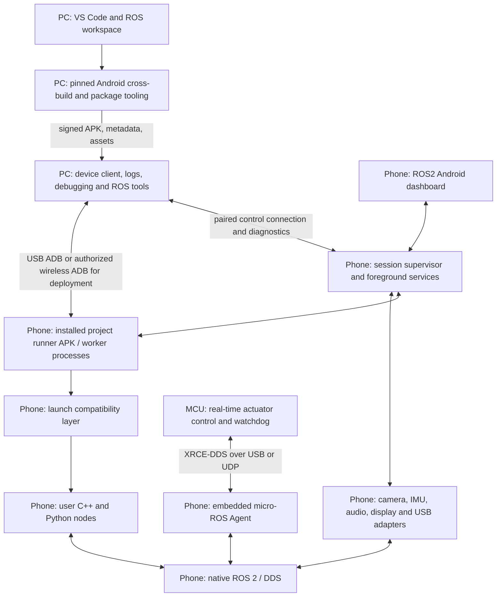

# ROS2 Android platform plan

Product requirements and current priorities: [robot-computer requirements](PRODUCT-REQUIREMENTS.md)
(2026-10-26). This takes precedence over older feasibility-stage missing-feature
lists below. Distribution is moving to an installable host CLI, APK and versioned
SDK; see [local alpha packaging](HOST-PACKAGE.md). No public release yet.

Current UI milestone: main Projects controls separate runners through
signature-authenticated IPC (start/stop, state/nodes, connection and bounded
workspace logs). See PROJECTS.md and verification/2026-10-25-unified-project-controls.md.
Runner-per-workspace packaging remains; a shared runtime is future work.

Current checkpoint: standard workspace builds include the native core ROS CLI
and LaunchService. See [Android shell](ANDROID-SHELL.md) for measured scope;
broad Linux package/launch compatibility and MCU integration remain pending.

Planning baseline: 2026-10-24. Updated: 2026-10-25.
Status: roadmap with explicit implementation and verification boundaries.

Implementation update: continuous camera capture and service-owned sessions are
implemented in the 0.1.1 development build. Physical tests passed, including
29.677 received FPS over a ten-minute USB background run, 29.733 FPS in a
30-second Wi-Fi run, Activity recreation and notification Stop. See
[verification](verification/2026-10-25-camera-service.md). One-hour and cross-device
qualification remain pending. A separate C++ project runner now supports rclcpp,
custom messages, parameters, remapping and IMU computation on the phone.
ABI-2 adds bounded JSON launch for several compiled nodes sharing one executor.
The Python feasibility runner now embeds CPython/rclpy with verified typed
topics, parameters, custom messages, IMU computation and C++ interoperability.
A build-time ROS `.launch.py` adapter now resolves registered C++ nodes, launch
arguments, basic substitutions/conditions, scoped namespaces and Python includes;
see [ROS launch support](ROS-LAUNCH.md) and [knowledge base](PROJECT-KNOWLEDGE.md).
An ordinary three-package C++ colcon workspace now cross-builds and runs its
unchanged main() executables as separate supervised Android processes; see
[workspace workflow](COLCON-WORKSPACES.md). General/mixed workspaces, per-worker
restart policies, full ROS launch, physical PC
disconnection/endurance qualification and broader MCU USB support remain pending. Reference ESP32 UDP
phone-hosted XRCE-DDS Agent traffic and Agent restart/reconnect now pass; see
ESP32-WIFI.md. Reference CP2102 USB serial round-trip/restart also passes; see
ESP32-USB.md. The ROS-specific graph-manager wrapper is not yet bundled. The
initial operator UI pass now uses fixed navigation, expandable settings and a
bounded camera thumbnail; see [UI design](UI-UX.md). Installed-project discovery/navigation and shared runner controls now pass a
physical workspace flow (see [project controls](PROJECTS.md)); broader multi-workspace/device and accessibility/layout qualification and a possible Compose migration remain pending.

## Current delivery priority

The owner has deferred Google Play. Focus on a community alpha delivered through
APKs and PC tooling. Clean UI/UX and clear setup steps are primary release gates:
audit/design the core screens, implement consistent accessible controls, and
verify sensor and project flows before expanding mixed-workspace support. See
[community handoff](HANDOFF.md) for ordered work and acceptance criteria. No
store preparation or public publishing is authorized by this roadmap update.

Accessibility/onboarding update: adaptive large-text navigation, quieter status
updates, API-appropriate headings and a direct battery-first path now pass scoped
physical checks. The prepared-machine walkthrough is documented in
[Getting started](GETTING-STARTED.md); a real new-contributor/clean-machine trial and
full TalkBack/keyboard/device qualification remain gates.

## Product outcome

Use an Android phone as the robot's main computer. Developers edit ROS packages
and launch files in VS Code on a PC, build for Android on the PC, deploy over USB
or Wi-Fi, and inspect nodes, logs, topics, parameters, and performance remotely.
After deployment, the robot runs on the phone and MCU without the development PC.
No full Ubuntu installation, root, or required Termux/container environment.

The product should feel familiar to ROS developers. Compatibility is earned per
package and feature; arbitrary Raspberry Pi binaries, apt packages, Linux device
drivers, and every launch action are not an initial promise. Android ARM64 uses
Android's ABI and platform APIs, so matching the CPU architecture is insufficient.

## What exists and what changes

- Implemented: Kotlin app, JNI, Jazzy rcl and Cyclone DDS, configurable hardware
  publishers, text subscriber, real PC interoperability over Wi-Fi and USB IP.
- Implemented feasibility: single-node rclcpp project APK builds and deployment.
- Missing: general workspace hosting, production package deployment,
  launch execution, process supervision, services/actions UI, persistent robot
  sessions, and the phone-hosted micro-ROS Agent.
- Original prototype camera: periodic Camera2 JPEG still requests, 1 FPS default,
  5 FPS limit. The new pipeline uses continuous YUV capture and bounded JPEG publishing.
- Original lifecycle: MainActivity.onPause stopped all endpoints. The new
  RobotSessionService owns runtime/hardware and survives Activity navigation.

Preserve v0.1 = PC/phone and v0.2 = phone/MCU. Add platform milestones around
those boundaries rather than quietly claiming v0.1 already runs arbitrary nodes.

## Architecture



Development/control traffic and ROS data traffic are distinct. USB ADB can
install, debug and forward a TCP control connection; DDS UDP uses the validated
USB tethering or Wi-Fi IP link. Neither ADB connectivity nor topic discovery alone
proves that sensor samples arrive. Normal operation must survive PC disconnection.

### Android controller and hardware services

Keep Kotlin for permissions, hardware APIs, lifecycle, connection management and
UI. Introduce a session supervisor with explicit stopped, starting, running,
degraded, stopping and failed states. The Activity observes state and issues
commands; it does not own ROS contexts or camera lifetime.

Use appropriate foreground-service types, notification controls and explicit
user-started robot sessions. Acquire wake resources only during active sessions.
Background/screen-off behavior is a device-tested capability, not an unconditional
guarantee. Generic background-start or reboot-start camera capture must not be
promised: Android restricts it, especially on recent releases.

### User-code execution and deployment

Recommended first path: a stable controller app plus one generated project-runner
APK per robot workspace. Package native code and dependencies in the APK and
install/update it through Android's supported installer/ADB development flow.
Do not design around copying ELF executables into writable storage and chmod/exec.
Android 10+ restricts that execution model.

The runner loads packaged C++ libraries through a small versioned runner API.
Port rclcpp and component loading before claiming conventional C++ node support.
Offer a documented wrapper for main()-style nodes; normal Linux process spawning
is not automatically available. Launch assets and the ament resource index travel
with the runner, including package-share resources and generated interfaces.

Use a separate runner app/process from the controller so a user-node crash does
not directly kill hardware capture or UI. Within a runner, provide a bounded,
manifest-declared pool of worker services for isolation where needed. Components
sharing a worker share its failure boundary. Android may still kill processes;
a separate process is not a security sandbox or a guarantee of uptime.

Controller/runner IPC must authenticate the paired project and expose narrow
lifecycle/status operations. Runner packages carry a project ID, runtime ABI,
ROS/dependency versions, required capabilities, hashes and build ID. Native
changes require an APK update initially. Never advertise unrestricted hot reload.
Stop and verify worker termination before replacing it; preserve controller config.
Keep the previous installable artifact and data/config version rules for recovery.

### Build and dependency strategy

Build on the PC with a pinned Android NDK, CMake, colcon integration and dependency
cache. Keep host generators separate from Android target libraries. Generate
custom .msg/.srv/.action type support for both PC and phone. Reject incompatible
ABI, Android API level, Python ABI or ROS dependency combinations before deployment.

Initially target the existing ARM64 phone and Jazzy dependency baseline. Port and
test packages individually. Prebuilt Linux wheels and apt packages do not become
Android packages by copying them. Release runtime SDK artifacts with licenses and
checksums so every project does not rebuild the entire ROS dependency tree.

### Python and launch files

C++ user-node hosting and the basic Python feasibility gate have passed on the
tested phone. The Python runner embeds CPython 3.12.15 and cross-built Jazzy
rclpy. See [Python projects](PYTHON-PROJECTS.md) for commands and boundaries.
Python package compatibility and launch execution require separate qualification.

Aim to reuse upstream launch/launch_ros descriptions with an Android execution
adapter. Standard Node actions normally start executables; simply bundling the
Python launch library does not solve process execution. The adapter maps supported
node actions to registered runner workers/components. Maintain a published matrix:

| Feature | Initial commitment |
| --- | --- |
| C++ nodes, names, namespaces, parameters, remapping | First user-runtime milestone |
| Launch arguments, substitutions, includes, conditions, timers | Incremental launch milestone |
| Node and ComposableNode actions | Android worker/component mapping, verified subset |
| Startup ordering, exits, bounded restart and shutdown | Supervisor integration |
| Python rclpy nodes | Single-node feasibility passed on Android 12 ARM64; broader package support pending |
| Lifecycle nodes, service/action tools, rosbag2 | Separate package-level ports and tests |
| ExecuteProcess, shell/systemd commands and Linux-specific drivers | Unsupported unless a specific Android mapping exists |

Preserve standard file syntax where semantics can be supported, and fail early
with actionable diagnostics for unsupported actions. A limited YAML project
manifest is acceptable for the first C++ proof but must not be presented as full
ROS launch compatibility. If rclpy/launch portability fails, record the exact gap
and revisit the runtime design before presenting a complete-platform claim.

## Camera performance plan

Replace repeated still captures with continuous capture. Camera2 is justified for
explicit stream control and sensor timing; keep it behind a replaceable adapter.

1. Query actual stream combinations, YUV sizes and FPS ranges on the device.
2. Use repeating preview/video capture with YUV_420_888 frames for processing.
3. Put acquisition, conversion/encoding and ROS publishing on bounded worker
   queues. Never perform DDS writes on the camera callback thread. Drop stale
   frames rather than accumulate latency. Instrument every stage and buffer copy.
4. Provide separate outputs: efficient on-phone image access for local nodes,
   a normal ROS Image/JPEG CompressedImage path for tools, and later a hardware
   MediaCodec H.264 preview transport for smooth remote viewing. Select and
   document an explicit compatible receiver/transport; H.264 is not JPEG and must
   not be mislabeled as a drop-in JPEG CompressedImage stream.
5. Add capture timestamps based on sensor timing, documented monotonic-to-ROS
   clock mapping, optical frames, exposure metadata and calibration-aware
   CameraInfo. Do not invent camera calibration.
6. Show requested FPS, captured FPS, published FPS, received FPS and dropped
   frames independently. Separate local preview performance from network delivery.

Initial benchmark goals, subject to measured phone capability:

- Local preview: 640x480 at 30 FPS where the camera supports it.
- ROS JPEG: at least 15 received FPS at 640x480 for 10 minutes on the reference
  USB link; characterize Wi-Fi separately and test 30 FPS as a stretch target.
- Interactive preview: target under 200 ms end-to-end at the 95th percentile;
  measure with synchronized clocks or a camera-visible timing method.
- Report CPU/RAM, bandwidth, temperature, throttling and lost frames. If a goal
  fails, identify capture, encoding, copying, middleware or network bottlenecks.

These are acceptance targets, not performance already demonstrated.

## Developer experience

Keep source and builds on the PC. Start with CLI tooling plus VS Code tasks;
build a VS Code extension only after the workflow is stable. Proposed commands
below do not exist yet:

```text
ros2android devices
ros2android build --project my_robot
ros2android deploy --device phone
ros2android launch my_robot bringup.launch.py
ros2android logs --follow
ros2android stop
```

The loop should be edit -> incremental build -> deploy -> launch -> inspect.
Provide compiler errors in VS Code, native debug symbols and attach support,
structured phone logs, node state/exit reason, parameter editing and remote topic
inspection. Debugging arbitrary app internals through a simulated SSH shell is
not required. PC ROS CLI tools remain useful for the normal ROS graph.

Use authorized USB ADB first. Add authorized wireless ADB deployment where the
phone supports it and paired encrypted control over Wi-Fi; never expose an
unauthenticated network code-execution endpoint. Initially use a trusted ROS LAN;
DDS access control/security is a separate validated requirement before use on
untrusted networks. Native development deployment and store distribution need
separate packaging/policy decisions.

## UI and interaction plan

Migrate the programmatically constructed Activity to Jetpack Compose and Material
3 with a state-driven ViewModel/service boundary. Make that boundary first;
changing the UI toolkit alone will not fix runtime reliability.

Phone navigation:

| Screen | Purpose |
| --- | --- |
| Overview | Robot state, active project, node count, link health, battery/thermal state, Start/Stop |
| Hardware | Compact searchable sensor list, front/back cameras, availability and live activity |
| Projects | Installed build, launch profiles, arguments, start/stop/restart and deployment result |
| ROS graph | Nodes/topics/services/actions, type, QoS and activity as implemented |
| Diagnostics/settings | Filtered logs, failed components, connection profiles, permissions and versions |

Use concise rows and a detail screen/bottom sheet for configuration instead of
large forms for every sensor. Camera detail has a local preview and resolution,
FPS, encoding, topic and QoS controls. Preserve edits, show validation inline,
distinguish saved configuration from active state, and handle portrait/landscape.
Avoid rebuilding the whole screen for counters. Provide accessible controls and
clear empty, unavailable, permission-denied, disconnected and failed states.

The PC is the primary coding interface; the phone is the operator console.

## Delivery order and evidence

| Milestone | Work | Completion evidence |
| --- | --- | --- |
| A: Camera correction | Continuous capture, bounded pipeline, timestamps, metrics, viewer defaults | Measured FPS/latency/thermal report, stable ROS tool viewing |
| B: Runtime lifecycle | Service ownership, persisted profiles, state machine, logs, restart rules | Camera + IMU survive UI navigation and supported screen-off cases; 1-hour soak; stop releases resources |
| C: User-node feasibility | PC builds rclcpp talker/listener project runner; custom message and crash recovery | User edits code on PC, deploys, runs on phone; PC disconnects and phone computation continues |
| D: MCU autonomy (v0.2) | Phone-hosted Agent UDP then USB, one reference board, watchdogs | Phone-node/MCU exchange with no PC Agent; unplug/reconnect and expired-command behavior proven |
| E: Workspaces and launch | SDK packaging, node workers, launch adapter, embedded Python gate | Multi-node launch with params/remaps/includes, observable exits/restarts; clear unsupported-feature errors |
| F: Product quality | Compose screens throughout, calibration flow, package support matrix and releases | End-to-end install/develop/deploy/run guide; recovery and compatibility checks on a second phone |

Do the native runner and Python/launch feasibility spikes before a large UI
redesign or porting navigation/SLAM stacks. Introduce UI improvements as each
runtime feature gets a stable API. Keep C++ and Python feasibility as independently
reported results. Plan dates only after the first spikes reveal porting effort.

End-to-end demonstration: phone captures camera and IMU, runs a custom perception
node, exchanges a higher-level command/status with an MCU, and continues after
PC disconnection. MCU retains command expiry and actuator timing. Reconnect the
PC, inspect logs, rebuild one node, deploy and restart it without losing saved
hardware configuration. Exercise a deliberate worker crash and a dropped link.

## Decisions and scope

- Native Android runtime, Kotlin shell, C++ computation, PC-side builds.
- Native project APK deployment before dynamic native plugin loading.
- C++ first; Python and launch behavior have explicit feasibility gates.
- Standard ROS interfaces and tools wherever their actual semantics are supported.
- No universal phone/version promise; publish tested per-feature compatibility.
- Do not change package IDs solely for branding or invalidate existing device data.
- The roadmap separates completed evidence from proposed milestones; source and
  physical verification documents describe each development build.

## Primary references

- Android executable-code restrictions: https://developer.android.com/about/versions/10/behavior-changes-10
- Android process boundaries: https://developer.android.com/guide/components/processes-and-threads
- Foreground-service types and camera restrictions: https://developer.android.com/develop/background-work/services/fgs/service-types
- Continuous camera requests and stream behavior: https://developer.android.com/media/camera/camera2/capture-sessions-requests
- Embedded Python on Android: https://docs.python.org/3.14/using/android.html
- ROS 2 composition: https://github.com/ros2/demos/tree/jazzy/composition
- ROS 2 launch Node action implementation: https://github.com/ros2/launch_ros/blob/jazzy/launch_ros/launch_ros/actions/node.py

Sources establish platform mechanisms; the Android ROS ports, launch adapter,
performance goals and recovery behavior above still require implementation proofs.
