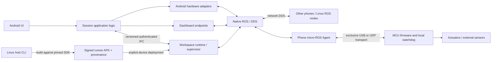

# ROS2 Android: high-level design

Status: proposed target design, 2026-11-01. This is a maintenance plan, not a claim
that these boundaries or release gates are already implemented. Current behavior
is documented in [Architecture](../../ARCHITECTURE.md).

## Product contract

ROS2 Android makes a supported Android phone the robot's application computer:
run supported ROS nodes and launch descriptions locally, expose phone hardware,
connect MCU devices, and develop/deploy from Linux without a mandatory PC relay.
It provides observable operation and recovery, rather than promising every Linux
package, every Android phone, or hard real-time execution.

The initial supported line stays ARM64, ROS 2 Jazzy, and documented Android/API
combinations. The current build has minSdk26/targetSdk35. Build targets are not
physical qualification. Preserve standard ROS message meanings, units and frames.
Motor PWM tuning, ball recognition and robot-specific control belong to robot
applications. No cloud account, on-phone IDE, container stack or plugin marketplace
is needed for the community alpha.

## System and trust boundaries



DDS carries ROS data directly. App/runner IPC manages operation; ADB handles
explicit development and deployment. Neither is a compulsory ROS data relay.
Sensor capture, Dashboard display and workspace execution have independently
owned lifetimes. A session coordinates selected components without making the
Activity their owner. The MCU retains actuator deadlines and local command expiry.

| Boundary | Owns | Must not own |
| --- | --- | --- |
| Operator app | Permissions, concise UI, configuration and observed readiness | Ball-tracking algorithms or motor tuning |
| Session logic | Requested operations, component state, startup/stop ordering | Android views, raw USB transfers or DDS implementation |
| Hardware/ROS adapters | Sensor capture, encoding, typed ROS endpoints, resource cleanup | Product navigation or robot behavior |
| Workspace runtime | User code, owned jobs, launch, exit status, bounded logs | Main-app hardware permissions or arbitrary other apps |
| Host client | Device selection, compatibility inspection, cross-build, deployment | Persistent runtime dependency on the PC |
| SDK | Pinned ROS/NDK/Python/native artifacts and compatibility metadata | Per-robot configuration or release signing secrets |
| MCU | Hardware I/O, fast local control and independent timeout | Camera processing or app lifecycle |

Android service startup and camera permissions impose real lifecycle constraints;
boot/autonomous recovery must be qualified per capability and Android version.
See [Android foreground-service restrictions](https://developer.android.com/develop/background-work/services/fgs/restrictions-bg-start).
ROS real-time behavior also requires bounded scheduling and execution; a successful
node demo does not prove deadlines. See [ROS real-time documentation](https://raw.githubusercontent.com/ros2/ros2_documentation/jazzy/source/Tutorials/Demos/Real-Time-Programming.rst).

## Repository boundaries

Recommendation: maintain two repositories, with one integration/release matrix.
Do not create a repository for every small demo or split the platform by language.

| Repository | Contents |
| --- | --- |
| ros2-android | Android app, runner implementations, native runtime, host package, SDK/build provenance, platform tests, operator/developer docs and minimal compatibility fixtures |
| ros2-android-examples (proposed) | Ball follower, application launch/configuration, Dashboard presets, reference motor firmware/wiring, experiment instructions and reproducible example tests |

Keep battery/basic sensor walkthroughs, minimal C++/Python talkers and a small
workspace/interface fixture in the platform repository: they diagnose platform
regressions without depending on robot perception. Separate a generic MCU transport
smoke test from ESP32/L298N motor application code. Shared platform code must not
import the examples repository, its topic names or its tuning parameters.

Examples consume a published/pinned SDK/CLI contract. Pin the example revision
used by platform integration tests; test released examples against a supported
platform version. Use optional integration checkout in CI, not a mandatory Git
submodule. Keep examples buildable and testable on ordinary Linux ROS where
practical. Preserve Apache-2.0/NOTICE/citation metadata during extraction.

The split is proposed, not executed. Create and verify the external build journey
before deleting local copies or changing working guides. Keep a tagged/committed
working baseline and migrate one example at a time.

## Proposed platform layout

```text
android/
  app/                 # UI, session logic and Android/ROS adapters
  runner/              # shared lifecycle/control and native runner
  pythonRunner/        # Python backend
  workspaceRunner/     # ordinary workspace process backend
native/                # ROS bridge, runner/native helpers, pinned patches/locks
python/ros2android/     # actual host command implementation and reusable backends
contracts/             # versioned manifest/protocol schemas and conformance fixtures
examples/smoke/        # small platform compatibility tests, not robot behaviors
tests/                 # host/native/contract/integration tests, as extracted
setup/                 # contributor bootstrap and thin build/install entry points
tools/                 # thin development/diagnostic entry points
docs/                  # journeys, design, decisions, compatibility and release policy
```

These are destination responsibilities, not instructions for a bulk directory
move. Keep existing entry points working while migrating implementation into
packages. Add Gradle/CMake modules only when ownership/dependency or testing needs
justify them. Folder naming alone does not create separation.

## Distribution and workspace execution

Retain the current main APK plus hidden runner APK per workspace for the next
release. Centralize its lifecycle and packaging contract. A single arbitrary-code
container is a separate architectural investigation, not a quick cleanup.
Android restricts executing files from writable app directories; validate each
execution path against target SDK policy. See [Android execution restrictions](https://developer.android.com/about/versions/10/behavior-changes-10).

Release artifacts: main APK, host package, checksummed native SDK/runtime artifacts,
and matching runner templates. Keep Debian/APT publication deferred until these
are reproducible. Linux package installation must not silently deploy to a phone;
`device setup`/deployment selects an authorized device explicitly.

Every build records source revision/hash, ROS distro, SDK identity, Android ABI/API,
Python ABI if used, runner protocol/runtime versions, dependencies and signing
certificate fingerprint. Validate this manifest before deployment or start.

### Release-blocking signing decision

Today ProjectControlService and its permission require main app and runner to
share a signing identity. An official prebuilt main APK and arbitrary user-built
runners cannot share the maintainer's private release key. Never ship that key.
Android signature permissions are designed around certificate identity; see
[Android custom permissions](https://developer.android.com/guide/topics/permissions/defining).

Short-term developer builds can retain a locally generated key for both apps,
with explicit key backup and upgrade instructions. Before distributing an official
APK for user-built workspaces, design and review explicit project/signer pairing
with scoped caller verification. Unknown signers must not get a general command
service. Do not weaken the permission to an unguarded exported service.
Certificate rotation, runner upgrades, revocation and two independently signed
workspace authors must be tested. This trust design is a release gate.

## Communication and compatibility

Distinguish three contracts: ordinary ROS interfaces, app/runner management IPC,
and host build/deployment manifests. Version the latter two independently of
ROS distro/native ABI. Compatible protocol negotiation cannot repair a native ABI
mismatch. C++ and Python dependency compatibility must be checked explicitly.

Keep ROS QoS configurable with sensible sensor/control defaults and visible
incompatibility diagnostics. A displayed switch request is not an observed remote
application state. Model acknowledgement separately; transport reliability does
not replace it. See [ROS QoS policies](https://raw.githubusercontent.com/ros2/ros2_documentation/jazzy/source/Concepts/Intermediate/About-Quality-of-Service-Settings.rst).

Platform acceptance requires external workspace builds, PC-independent operation,
visible failures, known stop scopes and recovery, supported-device evidence and
freshness/resource measurements. Define exit criteria before adding features.
See [low-level design](LOW-LEVEL-DESIGN.md) and [delivery plan](MAINTENANCE-PLAN.md).
